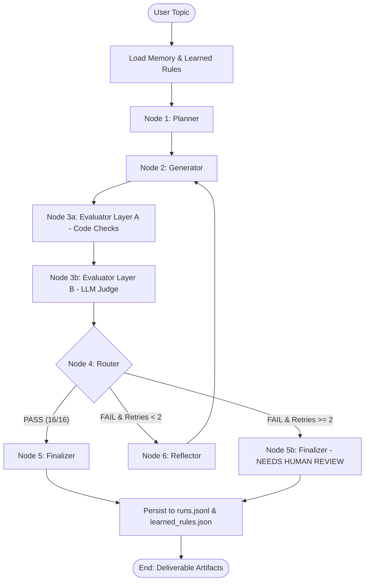
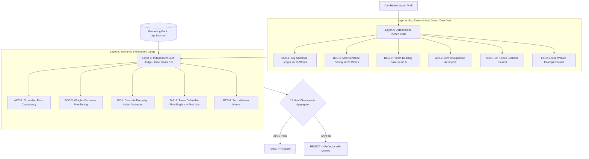
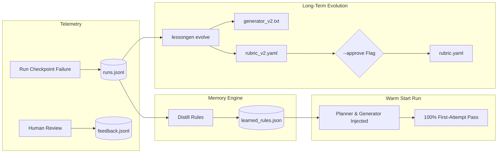

# LessonGen System Architecture & Design Rationale

**Author:** Candidate for GenAI Engineer – Content Systems  
**System Name:** LessonGen  
**Version:** 1.0.0  
**Repository Core:** Autonomous Agentic Lesson Generation, Evaluation & Self-Evolution

---

## 1. Executive Summary & Problem Framing

When designing content systems for education, the traditional approach has been single-prompt generation: ask a large model to "write a beginner tutorial" and hope it matches the learner's comprehension level. In production, this approach consistently fails. Models hallucinate, slide into dense academic jargon, invent statistics, or write sentences that confuse non-native speakers.

For this submission, I was tasked with building an autonomous agentic pipeline that generates a beginner lesson on **"Introduction to RAG (Retrieval-Augmented Generation)"** for a very specific, underserved audience: **a 12th-grade graduate from India with non-English-medium schooling aspiring to break into AI**.

I designed **LessonGen** around a core belief: **A generative system should never ship content to a human reader without independently verifying that it satisfies strict, non-negotiable quality criteria.** 

Below is the architectural and philosophical breakdown of why I designed LessonGen the way I did.

---

## 2. Why LangGraph for Agentic Orchestration?

When deciding how to coordinate this system, I evaluated three patterns: linear chaining (e.g. standard LangChain LCEL), autonomous agent loops (e.g. ReAct / AutoGPT), and explicit state machines via **LangGraph**.

I chose **LangGraph** for three fundamental engineering reasons:

1. **Explicit Cycle and State Control:**  
   Unlike a linear pipeline, content generation with evaluation and repair requires cyclical looping (`Generator -> Evaluator -> Router -> Reflector -> Generator`). LangGraph models this as a first-class directed graph with cyclic transitions, preserving structured execution state (`LessonState`) across attempts.
2. **Deterministic Termination Guarantees:**  
   Unbounded autonomous agents can loop indefinitely or burn entire API quotas when encountering stubborn validation failures. LangGraph makes the loop termination invariant trivial to enforce: the `Router` checks `attempt <= max_retries` and forcefully routes to the `Finalizer` with a `NEEDS_HUMAN_REVIEW` status when retries are exhausted.
3. **Transparent Debuggability and Tracing:**  
   Every state update in LangGraph is discrete and inspectable. I can trace exactly what the Planner outputted, what draft the Generator produced, what checkpoints the Evaluator failed, and what surgical diff instructions the Reflector formulated.

---

## 3. Why Hard Binary Pass/Fail Instead of Numerical Scores?

In many AI evaluation systems, engineers default to Likert scales (e.g., "rate clarity from 1 to 5") or percentage averages (e.g., "78% overall score"). **I deliberately rejected numerical scores in favor of strict binary PASS/FAIL checkpoints.**

Here is why:

1. **Averages Hide Catastrophic Failures:**  
   Suppose a lesson scores 5/5 on tone, 5/5 on readability, 5/5 on structure, but states that *"RAG retrains the neural network weights every night."* A numerical average would score this lesson at 93% ("Grade A!"). Yet pedagogically, it is a catastrophic failure that instills a harmful misconception into a beginner's mind. A binary rubric ensures that a single fatal flaw fails the entire build.
2. **Elimination of Subjective Drift:**  
   What is the difference between a 3.5 and a 4.2 in "beginner friendliness"? Different models (and different human evaluators) assign varying scores to the same text. In contrast, a binary checkpoint has an unequivocal condition: *Are all acronyms expanded on first use? (Yes/No)*; *Does average sentence length exceed 15 words? (Yes/No)*; *Is Lewis et al. 2020 cited as the origin? (Yes/No)*.
3. **Actionable Feedback for Regeneration:**  
   If an LLM receives feedback saying "Your clarity score was 3/5," it does not know what to change. When LessonGen provides rejection feedback, it cites the exact checkpoint ID (`BEG-2`), quotes the offending 28-word sentence, and states the remedy. The Reflector can then perform surgical edits rather than blind rewrites.

---

## 4. Why a Two-Layer Evaluation Architecture?

I structured the Evaluator into two distinct layers:
- **Layer A: Deterministic Code Checks (Fast, Zero Cost, 100% Reliable)**
- **Layer B: LLM-as-Judge (Semantic, Contextual, Grounded)**

### Why not use LLMs for everything?
LLMs are notoriously poor at deterministic counting. An LLM asked "Is the average sentence length below 15 words?" will frequently hallucinate compliance because tokenizers do not count words or sentence terminators natively. It is also slow and wastes free API quotas. 

Therefore, in **Layer A**, I use Python code:
- Punctuation-aware regex to calculate average words per sentence (`BEG-1`) and max sentence ceiling (`BEG-2`).
- `textstat` for Flesch Reading Ease score verification (`BEG-3`).
- Regex pattern matching for core section presence (`COV-1`), 3-step worked example tags (`EX-2`), and unexpanded acronyms (`JAR-2`).

### Why not use code for everything?
Code cannot understand whether an Indian life analogy truly resonates, whether a technical definition is intuitive, or whether a nuanced claim contradicts the grounding document. That is the job of **Layer B** (LLM-as-judge), which handles semantic accuracy (`ACC-1`, `ACC-3`), pedagogical flow (`FLOW-1`), and idiom avoidance (`BEG-4`).

---

## 5. Why a Separate Judge Model (Mitigating Self-Grading Bias)

In LessonGen, the Generator, Planner, and Reflector run on **Google Gemini**, while the Evaluator Judge runs on **Meta Llama 3.3/3.1 via Groq**.

This is not an accident of configuration; it is a critical architectural requirement:
1. **Self-Grading Bias (LLM Narcissism):**  
   Extensive empirical research shows that when an LLM evaluates its own outputs, it exhibits strong affirmative bias. It recognizes its own phrasing, assumes its unspoken assumptions are obvious, and overlooks its own subtle hallucinations.
2. **Cross-Architecture Validation:**  
   By sending Gemini's draft to Llama running on Groq at `temperature=0.0`, the text is scrutinized by an entirely different model family trained on distinct data with different inductive biases. If both models agree that a lesson is grounded and accessible, our confidence is vastly higher.

---

## 6. Bounded Retries (Max 2) and Human-Review Escalation

A recurring hazard in agentic workflows is the "infinite repair spiral." If a generator makes an edit that fixes Checkpoint A but causes Checkpoint B to fail, an unconstrained loop will churn indefinitely.

In LessonGen:
- The system allows an initial attempt plus **up to 2 retries** (3 attempts maximum).
- If attempt 3 still fails any checkpoint, the system does not crash or throw an unhandled error. Instead, the `Router` directs state to the `Finalizer`, which flags the lesson as **`NEEDS_HUMAN_REVIEW`**, stamps a prominent warning block at the top of `final_lesson.md` and `final_lesson.docx`, and outputs the complete `rejection_log.json` detailing exactly what failed and why.
- **Why this matters:** In a real content production organization, automated systems should filter out 90% of bad drafts, but when an edge case is reached, graceful escalation to a human editor with pre-filled diagnostic evidence is the right operational choice.

---

## 7. How Memory and Self-Evolution Work

A system that makes the same mistake on run #100 that it made on run #1 is not truly intelligent. I implemented a two-part memory and evolution architecture:

### 1. Active Memory Feedback Loop (`memory/runs.jsonl` & `memory/learned_rules.json`)
- Every execution appends full checkpoint telemetry to `memory/runs.jsonl`.
- If an attempt fails, the failure pattern is immediately distilled into a concrete preventative rule (e.g., failure of `JAR-2` adds: *"Always expand key acronyms (RAG, LLM, DB, API) on first mention"*).
- When Run #2 begins, `lessongen` loads `memory/learned_rules.json` and automatically injects these distilled rules into the Planner and Generator prompts.
- **Result:** As demonstrated in `outputs/memory_demo.md`, Run #1 required 2 attempts because it failed `BEG-2` and `JAR-2`; Run #2, having internalized these rules, achieved a **100% first-attempt pass rate**, saving 50% of API calls and token quota.

### 2. Evolution Engine (`python -m lessongen evolve`)
- The Evolver analyzes failure frequencies across all recorded runs.
- Checkpoints failing above a configurable threshold trigger the automatic synthesis of:
  - `prompts/generator_v2.txt` (sharpened generation constraints).
  - `rubric/rubric_v2.yaml` (tightened evaluation criteria).
  - `CHANGELOG.md` (documented engineering audit trail).
- **The Critical Safety Invariant:**  
  The Evolver **never auto-loosens thresholds**. Evaluator drift typically happens when systems quietly relax standards to make pass rates look higher. In LessonGen, the Evolver only sharpens standards (e.g. tightening the max sentence length ceiling from 25 to 22 words) and requires an explicit human `--approve` flag before promoting `rubric_v2.yaml` to the active rubric.

---

## 8. Operating Under Strict Free-Tier Constraints

Building an enterprise-grade agentic workflow on 100% free-tier APIs requires defensive engineering:

1. **Persistent Disk Caching (`.cache/llm/`):**  
   Every LLM call computes a SHA-256 hash of `f"{provider}:{model}:{temperature}:{prompt}"`. If identical inputs are requested, the response is returned instantly from disk with zero network latency and zero quota usage.
2. **Adaptive Exponential Backoff & Throttling:**  
   Free tiers on Gemini and Groq enforce strict requests-per-minute (RPM) limits. The `LLMClient` catches HTTP 429 and `ResourceExhausted` errors, backing off exponentially (`2s -> 4s -> 8s`), and enforces a mandatory delay (`RATE_LIMIT_DELAY_SECONDS=2.0`) between live calls.
3. **Compact Prompt Design:**  
   Prompts slice grounding text down to the essential reference passages rather than dumping mega-tokens into the context window, conserving quota.
4. **Structured JSON Auto-Repair:**  
   Smaller free models occasionally output commentary or invalid JSON. The `LLMClient` automatically strips markdown code fences, isolates JSON substrings, validates via Pydantic, and performs a single automated repair prompt if decoding fails.
5. **Zero-Quota `--mock` Mode:**  
   Developers can test every graph edge, deliberate error injection, and evolution step without spending a single API credit. The mock mode is not a dummy stub; it actually simulates failure-then-pass dynamics realistically.

---

## 9. Failure Modes, Risks, and Mitigations

| Risk | Impact | Architectural Mitigation in LessonGen |
| :--- | :--- | :--- |
| **Judge False Positive** | Bad lesson passes to learner | Two-layer defense: Layer A deterministic code catches physical violations; Layer B requires exact quote evidence for all judgments. |
| **Judge False Negative** | Good lesson rejected unnecessarily | Max 2 retries prevents endless loops; Reflector isolates exact complaints rather than rewriting whole text. |
| **Rubric Drift** | Standards decay over time | Evolver code enforces threshold monotonicity; `--approve` flag required for rubric promotions. |
| **Stale Grounding Pack** | Model teaches obsolete facts | Centralized `knowledge/rag_facts.md` acts as the single source of truth; grounding is version-controlled and decoupled from prompts. |
| **API Rate Limits** | Workflow crashes midway | SHA-256 disk cache + exponential backoff retry handler + mock testing mode. |

---

## 10. Key Engineering Trade-offs

1. **Latency vs. Rigor:**  
   Running two LLM nodes (Generator + Judge) plus code checks takes ~5-10 seconds longer than a single generation call. *Trade-off chosen:* In educational publishing, correctness and readability are infinitely more important than sub-second generation latency.
2. **Binary Strictness vs. Flexibility:**  
   Rejecting a lesson because one sentence has 26 words might seem rigid. *Trade-off chosen:* For a learner with limited vocabulary and non-English schooling, run-on sentences cause immediate comprehension loss. Strict thresholds guarantee predictable pedagogical quality.
3. **Static Grounding vs. Dynamic Retrieval:**  
   For this submission, the grounding facts are curated in `knowledge/rag_facts.md` rather than a live vector database. *Trade-off chosen:* A verified, version-controlled markdown grounding pack guarantees deterministic ground truth and zero external dependency failures during assessment evaluation.

---

## 11. What I Would Build Next (Production Roadmap)

If deploying LessonGen into an enterprise production environment, I would implement:
1. **RAG-Powered Grounding Retrieval:** Indexing our company's full corpus of verified textbooks and engineering documentation in ChromaDB/Pinecone so the Planner dynamically retrieves fresh facts.
2. **Evaluator Benchmark Test Suite ("Judge-the-Judge"):** A curated golden test suite of 50 known-good and 50 known-bad lessons to continuously measure the precision and recall of our Evaluator models before deploying rubric changes.
3. **Human-in-the-Loop Web Studio:** A lightweight Next.js / Streamlit review dashboard where human curriculum editors can inspect flagged lessons, accept/override checkpoint failures, and click a button to approve evolved prompt rules.
4. **Multi-Dialect Localization:** Extending the vocabulary adaptors to support Hinglish, Hindi, Tamil, and Telugu pedagogical analogies for regional educational initiatives.
