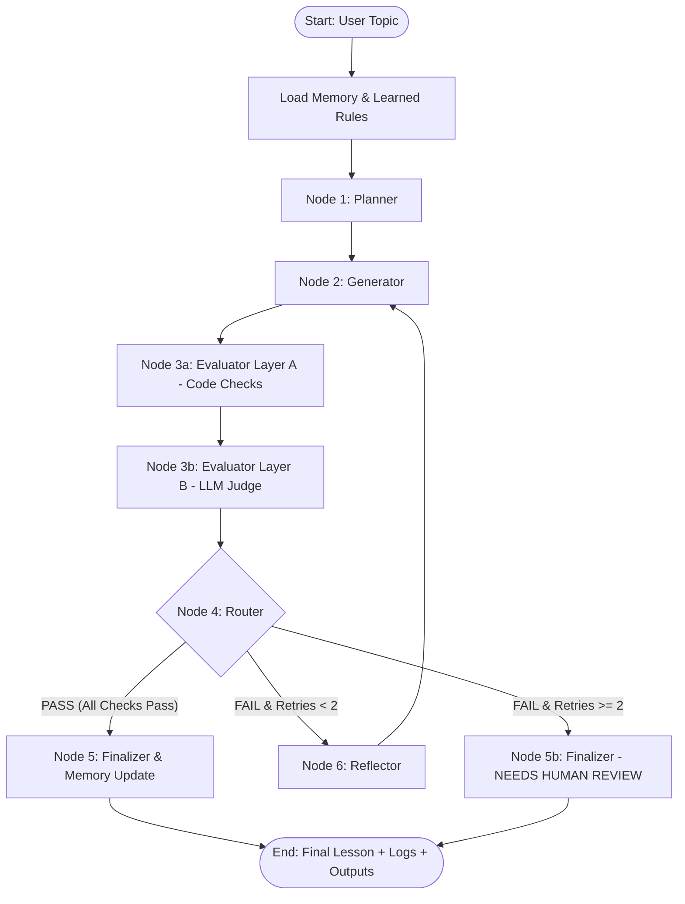

# Implementation Plan: GenAI Engineer - Content Systems Take-Home Submission

## 1. Project Overview & Target Persona
- **Project Goal:** Build an autonomous, self-evolving agentic content system that generates a beginner lesson for "Introduction to RAG (Retrieval-Augmented Generation)", evaluates it against a rubric of hard binary pass/fail checkpoints across two evaluation layers (deterministic code + LLM judge), and regenerates until passing (max 2 retries).
- **Target Learner:** 12th-grade graduate from India with limited English vocabulary and non-English-medium schooling aspiring to start an AI career.
  - Vocabulary: Simple, everyday conversational English.
  - Sentence length: Average <= 15 words; no single sentence > 25 words.
  - Terminology: Every technical term defined in plain English at or before first use; acronyms expanded immediately.
  - Analogies: Rooted in everyday Indian life (e.g., student in open-book exam, librarian finding a Hindi textbook, chai-stall owner keeping a notebook of regular customers' preferences).
  - Tone & Pedagogy: Encouraging, zero assumed ML/math background, clear problem -> intuition -> step-by-step mechanism -> worked example -> limitations -> self-check flow.
- **Cost Constraint:** 100% Free-Tier Architecture.
  - Generator / Planner / Reflector: Google Gemini API free tier (via `google-genai`).
  - Judge: Groq API free tier (e.g. `llama-3.3-70b-versatile` / `llama-3.1-8b-instant`) to prevent self-grading bias.
  - Fallback: Local Ollama model.
  - Fully functional `--mock` mode requiring zero API keys for testing, CI, and presentation rehearsals with deterministic failure-then-pass progression.
  - Free-tier safeguards: Persistent disk caching (`hash(prompt+model)`), exponential backoff rate limiter, compact prompt design, Pydantic schema validation with automatic single repair retry.

---

## 2. System Architecture & LangGraph State Flow



### State Machine Schema (`lessongen/state.py`):
```python
class LessonState(TypedDict):
    topic: str
    grounding_pack: str
    learned_rules: List[str]
    blueprint: Optional[LessonBlueprint]
    current_attempt: int
    max_retries: int
    draft_lesson: str
    injected_error: Optional[str]
    layer_a_results: List[CheckpointResult]
    layer_b_results: List[CheckpointResult]
    overall_passed: bool
    rejection_log: List[AttemptLog]
    final_status: str  # "PASSED" or "NEEDS_HUMAN_REVIEW"
    metrics: Dict[str, Any]
    trace: List[Dict[str, Any]]
```

---

## 3. Rubric Definition (15 Binary Checkpoints)
Defined in `rubric/rubric.yaml` (v1.0):
1. **Accuracy & Grounding (ACC)**
   - `ACC-1` (Judge): Every factual statement aligns strictly with `knowledge/rag_facts.md`.
   - `ACC-2` (Judge): No hallucinated or invented statistics, benchmarks, or citations.
   - `ACC-3` (Judge/Code): RAG is explicitly defined as *retrieval + generation*, never retraining or fine-tuning model weights.
2. **Beginner-Friendly Language (BEG)**
   - `BEG-1` (Code): Average sentence length <= 15 words across the lesson.
   - `BEG-2` (Code): No single sentence exceeds 25 words.
   - `BEG-3` (Code): Flesch Reading Ease score >= 65.0 (or equivalent beginner readability threshold).
   - `BEG-4` (Judge): Strictly zero Western slang, obscure idioms, or patronizing academic prose.
3. **Teaches by Example & Analogy (EX)**
   - `EX-1` (Judge/Code): Contains at least one relatable Indian everyday life analogy (open-book exam, librarian, or chai stall).
   - `EX-2` (Judge/Code): Contains at least one clear worked example formatted as: Learner Question -> Retrieved Reference Chunks -> Final Generated Answer.
4. **Jargon & Acronym Clarity (JAR)**
   - `JAR-1` (Judge/Code): Every technical term (embeddings, vector database, chunking, context window, hallucinations) is defined in plain words at or before its first appearance.
   - `JAR-2` (Code): No unexplained acronyms (e.g., RAG, LLM, DB, API must be expanded upon first mention).
5. **Coverage & Completeness (COV)**
   - `COV-1` (Judge/Code): Explicitly covers all three core pedagogical pillars: What it is, Why it matters, and How it works.
   - `COV-2` (Judge): Covers all essential concepts mandated by blueprint (knowledge cutoff, chunking, vector database, retrieval, generation).
   - `COV-3` (Judge): Explicitly includes practical limitations and failure modes of RAG (garbage in garbage out, retrieval latency, chunking boundary misses).
6. **Teaching Flow & Active Recall (FLOW)**
   - `FLOW-1` (Judge): Coherent progressive flow: Problem -> Intuition/Analogy -> Step-by-Step Architecture -> Worked Example -> Limitations -> Summary.
   - `FLOW-2` (Judge/Code): Concludes with a Quick Summary and 3 to 5 self-check questions complete with clear answers.

---

## 4. Phase-by-Phase Implementation Plan

### Phase 1: Foundation & Grounding Data
- Create project directory skeleton:
  - `lessongen/`, `lessongen/nodes/`, `lessongen/evaluator/`, `knowledge/`, `rubric/`, `prompts/`, `memory/`, `outputs/`, `tests/`, `docs/`.
- Configure `requirements.txt`: `langgraph`, `google-genai`, `groq`, `pydantic`, `python-docx`, `textstat`, `pyyaml`, `pytest`, `python-dotenv`.
- Setup `.env.example` and ensure `.env` is listed in `.gitignore`.
- Write `knowledge/rag_facts.md` covering verified historical origin (Lewis et al., 2020), retrieval + generation pipeline, vector embeddings, chunking, context window limitations, hallucinations, knowledge cutoff, and RAG vs. Fine-Tuning.
- Write `rubric/rubric.yaml` with version 1.0 specifications for all 15 checkpoints.
- **Verification:** Run unit test checking rubric schema validity and existence of grounding knowledge.

### Phase 2: LLM Abstraction Layer & Core Generative Nodes
- Create `lessongen/llm.py`:
  - Provider agnostic caller supporting `gemini` (via `google-genai`), `groq` (via `groq`), `ollama`, and `--mock`.
  - Disk-backed SHA256 caching in `.cache/llm/` to ensure zero quota waste on repeated or debug runs.
  - Rate-limit handler with exponential backoff and inter-call delay.
  - Pydantic structured output enforcement with automatic single-repair prompt on malformed JSON.
  - Deterministic mock engine that accurately simulates realistic candidate drafts and exercises failure modes.
- Implement prompts in `prompts/`:
  - `planner.txt`: Focuses on Indian beginner constraints, syllabus structure, and learned rules injection.
  - `generator.txt`: Rigorous tone, Indian life analogies, bracketed glossary definitions, and short sentence constraints.
  - `reflector.txt`: Analyzes exact failing checkpoint IDs and quotes, outputting surgical edit instructions.
- Implement `lessongen/nodes/planner.py` and `lessongen/nodes/generator.py`.
- **Verification:** Unit test Planner and Generator in mock mode, validating output shapes and blueprint structure.

### Phase 3: Two-Layer Evaluator Engine
- Implement `lessongen/evaluator/layer_a.py` (Deterministic Code Checks):
  - Tokenization and sentence splitting with punctuation awareness.
  - Sentence length calculations (mean words per sentence <= 15, max sentence <= 25).
  - Readability metric using Flesch Reading Ease via `textstat`.
  - Required sections parser (What, Why, How, Example, Limitations, Summary, Self-Check Questions).
  - Glossary & acronym order detector (verifies expansion/definition occurs at or before first usage).
  - Worked example detector (Question, Retrieved Chunks, Answer).
- Implement `lessongen/evaluator/layer_b.py` (LLM-as-Judge):
  - Independent Groq/Llama judge prompt isolating reasoning from generator perspective.
  - Strict Pydantic model: `EvaluatorJudgment(checkpoints=[CheckpointResult(id, passed, evidence, reason)])`.
  - Grounding adherence check against `knowledge/rag_facts.md`.
  - Verifies analogies, lack of Western slang/idioms, and overall teaching flow.
- Combine into `lessongen/evaluator/engine.py` producing unified pass/fail verdict.
- **Verification:** Test Layer A and Layer B against synthetic good and bad lesson fixtures (e.g. intentionally long sentences, undefined acronyms, factual errors).

### Phase 4: LangGraph Workflow, Reflector, Finalizer & CLI
- Build `lessongen/nodes/reflector.py`:
  - Compiles failure reasons and generates explicit diff summaries and edit instructions.
- Build `lessongen/nodes/finalizer.py`:
  - Formats passing or flagged lesson into `outputs/final_lesson.md`.
  - Generates `.docx` file using `python-docx`.
  - Generates `outputs/rejection_log.md`, `outputs/rejection_log.json`, and `outputs/run_trace.json`.
- Assemble LangGraph state machine in `lessongen/graph.py` with conditional routing (`max_retries = 2`).
- Implement CLI in `lessongen/cli.py` (`python -m lessongen run --topic "..." [--mock] [--inject-error ...]`).
- **Verification:** Test end-to-end graph execution under mock mode, verifying proper branch traversal, retry counting, and output artifact generation.

### Phase 5: Persistent Memory, Self-Evolution Engine & Error Injection
- Implement `lessongen/memory.py`:
  - Append-only persistent execution log `memory/runs.jsonl`.
  - Persistent rule repository `memory/learned_rules.json`.
  - Feedback recording: `python -m lessongen feedback --run <id> --text "..."`.
- Implement `lessongen/evolver.py` (`python -m lessongen evolve`):
  - Aggregates checkpoint failure frequencies across `runs.jsonl`.
  - Identifies recurring failure patterns (e.g., repeated `JAR-1` or `BEG-1` failures).
  - Generates improved `prompts/generator_v2.txt`, sharpened `rubric/rubric_v2.yaml`, and detailed `CHANGELOG.md`.
  - Enforces safety invariant: Rubric thresholds can NEVER be auto-loosened; human approval flag required.
- Implement `--inject-error [factual|jargon|missing-example]` flag:
  - Factual: Injects claim that RAG updates neural network weights.
  - Jargon: Introduces undefined acronyms ("dense vectors computed via HNSW indexes") and 30+ word sentences.
  - Missing-example: Omits the worked retrieval walkthrough.
  - Evaluator catches error on Attempt 1 -> Reflector formulates fix -> Attempt 2 passes.
  - Writes demonstration trace to `outputs/demo_rejection_log.md` and comparison to `outputs/memory_demo.md`.
- **Verification:** Test memory logging, rule synthesis, evolution CLI, and deliberate error recovery in pytest.

### Phase 6: Documentation, Video Walkthrough Script & Interview Defense
- Produce comprehensive documentation:
  - `README.md`: Architecture diagram, setup guide, API key acquisition instructions, CLI commands, sample output.
  - `DESIGN.md`: Deep architectural justification written in the first person covering design tradeoffs, free tier handling, two-layer evaluation philosophy, self-grading bias mitigation, and evolution safety.
  - `docs/architecture.mmd`: Standalone Mermaid source.
  - `docs/VIDEO_SCRIPT.md`: Timestamped 15-20 minute Loom walkthrough script.
  - `docs/SUBMISSION_CHECKLIST.md`: Verification checklist for code, docs, and delivery artifacts.
  - `docs/INTERVIEW_QA.md`: Defensible Q&A answers on evaluation edge cases, drift prevention, and scalability.
- Run full suite of automated tests (`pytest tests/ -v`).
- Execute end-to-end pipeline in `--mock` mode across normal run, deliberate error run, feedback injection, and evolution generation.
- Produce final summary report with actionable manual steps.

---

## 5. Verification & Test Plan
1. `tests/test_layer_a.py`: Validates deterministic sentence length, readability, section headers, acronym detection, and worked example validation.
2. `tests/test_layer_b.py`: Tests judge prompt parsing, Pydantic validation, and rejection of known-bad lesson drafts.
3. `tests/test_router.py`: Verifies state machine termination within max 2 retries and proper routing to human review on persistent failure.
4. `tests/test_memory.py`: Verifies logging to `runs.jsonl`, rule extraction, feedback addition, and prompt evolution without threshold relaxation.
5. `tests/test_pipeline_e2e.py`: Runs full end-to-end mock workflow ensuring all output artifacts (`final_lesson.md`, `final_lesson.docx`, `rejection_log.md`, `run_trace.json`) are correctly created.
