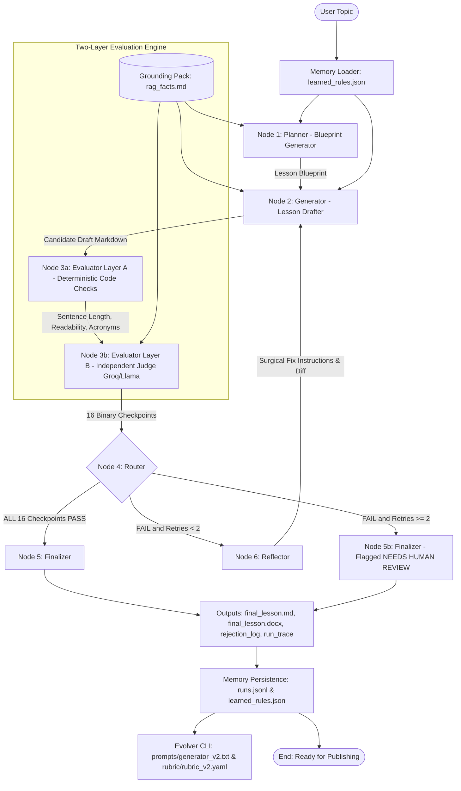
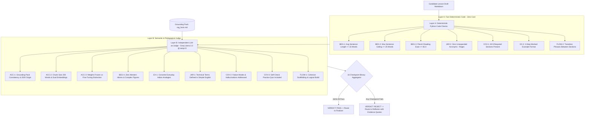
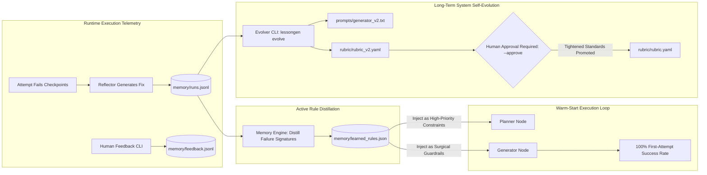

# LessonGen Studio: Autonomous Agentic Lesson Generator & Evaluator

❗️❗️Demo https://youtu.be/JLXvQfsOkpg

[](https://www.python.org/downloads/)
[](https://github.com/langchain-ai/langgraph)
[]()
[](http://127.0.0.1:8000)
[]()
[]()

> **GenAI Engineer – Content Systems Assessment Submission**
> An autonomous agentic content generation and evaluation engine that produces beginner technical lessons, audits them against **16 hard binary pass/fail checkpoints**, catches deliberate errors with verbatim quote citations, and self-heals candidate drafts before human review.

---

## 🎯 Target Learner Persona & Pedagogical Constraints


The system is rigorously optimized for an underserved audience:
**A 12th-grade graduate from India with non-English-medium schooling aspiring to break into AI engineering.**

### Strict Non-Negotiable Rules:
- **Sentence Length**: Average sentence length strictly $\le 15$ words; hard ceiling $\le 25$ words per sentence.
- **Readability**: Flesch Reading Ease score strictly $\ge 65.0$.
- **Analogies**: Relatable everyday Indian analogies (open-book exams, chai stall ledgers, school librarians). Zero confusing Western idioms.
- **Jargon Clarity**: Technical terms defined in plain English in brackets upon first use; zero unexpanded acronyms.
- **Accuracy**: RAG is retrieve-then-generate with **frozen model weights** (distinguished from fine-tuning); grounded in Lewis et al. 2020.

---

## 🏗️ System Architecture & Mermaid Diagrams

### 1. LangGraph Cyclic State Machine

Content generation with validation and repair is fundamentally a cyclic state machine. If an evaluation fails, the system dispatches failure diagnostics to the **Reflector Node**, which formulates surgical edits rather than blind rewrites:



---

### 2. Two-Layer Evaluation Philosophy (Code vs Judge)

We deliberately avoid soft Likert scores (e.g., "rate 1 to 5") because an average score of 4 out of 5 easily hides a fatal factual mistake. Every checkpoint is a **strict binary PASS or FAIL**:



---

### 3. Active Memory & Self-Evolution Loop

Memory in LessonGen is not just an append-only log file; it is an active feedback loop that prevents repeating historical mistakes:



---

## 💻 Interactive Web Studio Dashboard (`http://127.0.0.1:8000`)

LessonGen features a built-in FastAPI web dashboard providing full visual telemetry:

1. **Pipeline Execution Studio**:
   - Live graph node progression (`planner` ➔ `generator` ➔ `evaluator` ➔ `reflector` ➔ `generator` ➔ `evaluator` ➔ `finalizer`).
   - One-click deliberate error injection (`Factual Contradiction`, `Technical Jargon`, `Missing Example`).
   - Toggle between **Instant Offline Mock Mode** (~0.3s) and **Live Gemini + Groq API**.
2. **Rejection & Healing Log (`🛡️ Rejection Log`)**:
   - Visual cards showing failed checkpoints, failure reasons, verbatim evidence quotes cited directly from the draft, and the Reflector's surgical fix plan.
3. **16 Rubric Checkpoints Matrix (`📋 16 Checkpoints`)**:
   - Comprehensive breakdown of all Layer A (Deterministic Code) and Layer B (LLM-as-Judge) standards.
4. **Final Lesson & Word Document Export (`📖 Final Lesson`)**:
   - Formatted Markdown rendering alongside a one-click **"💾 Download .docx"** button.
5. **Memory & Evolution Inspector (`🧠 Memory & Evolution`)**:
   - Real-time viewer of `memory/learned_rules.json`, historical runs comparison, and an interactive **"Trigger Evolution Engine"** button.

---

## 🚀 Quickstart & Installation

### Prerequisites
- Python 3.11 or 3.12
- Git

### 1. Clone & Set Up Virtual Environment
```bash
git clone <your-repo-url>
cd gen_ai

python3 -m venv .venv
source .venv/bin/activate    # On Windows: .venv\Scripts\Activate.ps1

pip install -r requirements.txt
pip install -e .
```

### 2. Free API Key Setup (Zero Paid Subscriptions Required)
LessonGen is engineered to run 100% on free-tier APIs:
- [Google AI Studio](https://aistudio.google.com/) for Gemini keys.
- [Groq Console](https://console.groq.com/) for fast Llama-3.3 inference.

Copy the environment template:
```bash
cp .env.example .env
```
Edit `.env` and fill in your keys:
```env
GEMINI_API_KEY=your_gemini_key_here
GROQ_API_KEY=your_groq_key_here
```

---

## 🕹️ CLI Usage & Demonstration Modes

### A. Run Interactive Web Dashboard Studio
```bash
uvicorn lessongen.web.app:app --host 127.0.0.1 --port 8000 --reload
```
Open your browser at `http://127.0.0.1:8000`.

### B. Offline Mock Mode (Instant ~0.3s, Zero API Keys Needed)
Exercises the full cyclic LangGraph state machine, demonstrating Attempt 1 failure, Reflector surgical fix, and Attempt 2 pass:
```bash
python -m lessongen run --mock
```

### C. Live Free-Tier API Run
Executes live against Google Gemini and Groq:
```bash
python -m lessongen run --topic "Introduction to RAG (Retrieval-Augmented Generation)"
```

### D. Deliberate Error Demonstrations
```bash
# Inject factual contradiction (claiming RAG retrains model weights)
python -m lessongen run --mock --inject-error factual

# Inject jargon error (unexpanded acronyms, 30+ word sentences)
python -m lessongen run --mock --inject-error jargon

# Inject missing worked example
python -m lessongen run --mock --inject-error missing-example
```

### E. Trigger Memory Evolution Engine
```bash
# Analyze historical runs and generate proposals (dry-run)
python -m lessongen evolve --threshold 1.0

# Promote sharpened rubric standards (requires human approval)
python -m lessongen evolve --threshold 1.0 --approve
```

---

## 📂 Deliverable Output Artifacts

All run outputs are systematically persisted in the [`outputs/`](file:///Users/manishyadav/Desktop/gen_ai/outputs) directory:

| Artifact Path | Description |
| :--- | :--- |
| [`outputs/final_lesson.md`](file:///Users/manishyadav/Desktop/gen_ai/outputs/final_lesson.md) | Clean Markdown lesson tailored for Google Docs import. |
| [`outputs/final_lesson.docx`](file:///Users/manishyadav/Desktop/gen_ai/outputs/final_lesson.docx) | Fully styled Microsoft Word document with callouts and tables. |
| [`outputs/rejection_log.md`](file:///Users/manishyadav/Desktop/gen_ai/outputs/rejection_log.md) | Comprehensive audit log with verbatim quote evidence and reflector fixes. |
| [`outputs/rejection_log.json`](file:///Users/manishyadav/Desktop/gen_ai/outputs/rejection_log.json) | Structured machine-readable rejection telemetry. |
| [`outputs/run_trace.json`](file:///Users/manishyadav/Desktop/gen_ai/outputs/run_trace.json) | Chronological trace of LangGraph node executions and state payloads. |
| [`outputs/demo_rejection_log.md`](file:///Users/manishyadav/Desktop/gen_ai/outputs/demo_rejection_log.md) | Audit report verifying deliberate error catching. |
| [`outputs/memory_demo.md`](file:///Users/manishyadav/Desktop/gen_ai/outputs/memory_demo.md) | Quantitative comparison between Cold Start (Run 1) and Warm Start (Run 2). |

---

## 🧪 Automated Test Suite (24 Passed in 0.79s)

```bash
pytest -v
```
All 24 unit and integration tests validate:
- Schema and Grounding Pack integrity (`tests/test_phase1.py`)
- LLM cache hashing, JSON repair, and rate-limit backoff (`tests/test_phase2.py`)
- Layer A sentence length / readability checks and Layer B judge parsing (`tests/test_phase3.py`)
- LangGraph wiring, bounded retry termination, and document export (`tests/test_phase4.py`)
- Memory rule distillation, human feedback, and self-evolution (`tests/test_phase5.py`)

---

## 📁 Repository Structure

```
gen_ai/
├── lessongen/                 # Core Python engine
│   ├── graph.py               # LangGraph state machine & router
│   ├── state.py               # Typed state schema
│   ├── llm.py                 # Multi-provider client (Gemini/Groq/Mock/Cache)
│   ├── memory.py              # Memory persistence & rule distiller
│   ├── evolver.py             # Self-evolution engine (prompt_v2 & rubric_v2)
│   ├── cli.py                 # CLI commands
│   ├── nodes/                 # Graph nodes (planner, generator, reflector, finalizer)
│   ├── evaluator/             # Two-layer evaluation engine (layer_a, layer_b, engine)
│   └── web/                   # Interactive FastAPI Web Studio
│       ├── app.py             # API endpoints & static file server
│       └── static/            # Dashboard UI (HTML, CSS, JS)
├── rubric/                    # Rubric specifications (v1 active, v2 evolved)
├── knowledge/                 # Verified grounding pack (rag_facts.md)
├── prompts/                   # Prompt templates (planner, generator, reflector, judge)
├── memory/                    # Persistent telemetry (runs.jsonl, learned_rules.json)
├── outputs/                   # Generated submission deliverables
├── tests/                     # 24 unit & integration tests
├── docs/                      # Documentation & guides
│   ├── architecture.mmd       # Mermaid architecture diagram
│   ├── evaluator_flow.mmd     # Mermaid evaluator flow diagram
│   ├── memory_evolution.mmd   # Mermaid memory loop diagram
│   ├── VIDEO_SCRIPT.md        # Loom walkthrough script
│   ├── SUBMISSION_CHECKLIST.md# Final submission checklist
│   └── INTERVIEW_QA.md        # Technical interview defense Q&A
├── DESIGN.md                  # Deep architectural rationale & tradeoffs
├── PLAN.md                    # Initial engineering blueprint
├── CHANGELOG.md               # Evolution audit trail
├── requirements.txt           # Python dependencies
└── pyproject.toml             # Package configuration
```

---

